# Enhanced Entity-Relationship (EER) Diagram - Sci Market

This EER focuses on specializations (User subtypes), identifying weak/associative entities, and compositions.

```mermaid
classDiagram
    %% =====================
    %% Specialization (Inheritance)
    %% =====================
    class User {
        +int id
        +string email
        +string username
        +string phone
        +string full_name
        +string profile_picture
        +string language_preference
        +string theme_preference
        +bool is_active
        +bool is_staff
        +bool is_superuser
        +datetime created_at
        +datetime updated_at
        +datetime last_login
    }

    class Admin
    class Support
    class Seller
    class Buyer

    Admin --|> User
    Support --|> User
    Seller --|> User
    Buyer --|> User

    %% =====================
    %% Core Entities
    %% =====================
    class Wallet {
        +int id
        +int user_id
        +decimal balance
        +jsonb transaction_history
        +datetime created_at
        +datetime updated_at
    }

    class Category {
        +int id
        +string name_fa
        +string name_en
        +string slug
        +string description
        +int parent_id
        +bool is_active
        +int order_index
        +int level
        +datetime created_at
        +datetime updated_at
    }

    class Product {
        +int id
        +int seller_id
        +string title_fa
        +string title_en
        +string slug
        +text description_fa
        +text description_en
        +int category_id
        +decimal price
        +string file_path
        +string file_type
        +jsonb tags
        +int views_count
        +int download_count
        +string preview_image
        +bool is_active
        +bool is_featured
        +datetime created_at
        +datetime updated_at
    }

    %% Associative (Identifying) and Weak Entities
    class ProductFile {
        +int id
        +int product_id
        +string file_path
        +string file_name
        +int file_size
        +datetime upload_date
    }

    class Cart {
        +int id
        +int buyer_id
        +datetime created_at
        +datetime updated_at
    }

    class CartItem {
        +int id
        +int cart_id
        +int product_id
        +int quantity
        +decimal total_price
        +datetime added_at
    }

    class Order {
        +int id
        +int buyer_id
        +string order_number
        +decimal total_price
        +string status
        +string payment_method
        +string tracking_code
        +text notes
        +datetime created_at
        +datetime updated_at
    }

    class OrderItem {
        +int id
        +int order_id
        +int product_id
        +int quantity
        +decimal price
        +decimal total_price
    }

    class Transaction {
        +int id
        +int from_wallet_id
        +int to_wallet_id
        +decimal amount
        +string type
        +string status
        +text description
        +string reference_id
        +datetime created_at
    }

    class Ticket {
        +int id
        +int user_id
        +string subject
        +text message
        +string status
        +int assigned_to
        +datetime created_at
        +datetime updated_at
    }

    class TicketResponse {
        +int id
        +int ticket_id
        +int user_id
        +text message
        +datetime created_at
    }

    class Review {
        +int id
        +int user_id
        +int product_id
        +int rating
        +text comment
        +bool is_verified_purchase
        +datetime created_at
        +datetime updated_at
    }

    class Wishlist {
        +int id
        +int user_id
        +int product_id
        +datetime added_at
    }

    class AuditLog {
        +int id
        +int user_id
        +string action
        +string ip_address
        +jsonb details
        +datetime created_at
    }

    %% =====================
    %% Compositions / Aggregations / Associations
    %% =====================
    User "1" -- "1" Wallet : owns
    User "1" o-- "many" Product : sells
    User "1" o-- "1" Cart : has
    User "1" o-- "many" Order : places
    User "1" o-- "many" Ticket : creates
    User "1" o-- "many" TicketResponse : writes
    User "1" o-- "many" Review : writes
    User "1" o-- "many" Wishlist : has
    User "1" o-- "many" AuditLog : performs

    Wallet "1" o-- "many" Transaction : from
    Wallet "1" o-- "many" Transaction : to

    Category "1" o-- "many" Category : parent
    Category "1" o-- "many" Product : contains

    Product "1" *-- "many" ProductFile : has
    Product "1" o-- "many" CartItem : appears_in
    Product "1" o-- "many" OrderItem : appears_in
    Product "1" o-- "many" Review : receives
    Product "1" o-- "many" Wishlist : in

    Cart "1" *-- "many" CartItem : contains
    Order "1" *-- "many" OrderItem : contains

    Ticket "1" *-- "many" TicketResponse : has

    %% Notes
    note for CartItem "Weak/identifying entity dependent on Cart (logical)"
    note for OrderItem "Associative entity between Order and Product with attributes quantity, price"
    note for ProductFile "Identifying relationship: lifecycle owned by Product"
```

## Notes
- Inheritance models role-based specializations of `User` (Admin, Support, Seller, Buyer).
- `OrderItem` is an associative entity between `Order` and `Product` (M:N resolved).
- `CartItem` acts as a weak/identifying entity under `Cart`.
- `ProductFile` is composition under `Product` (owned lifecycle).

