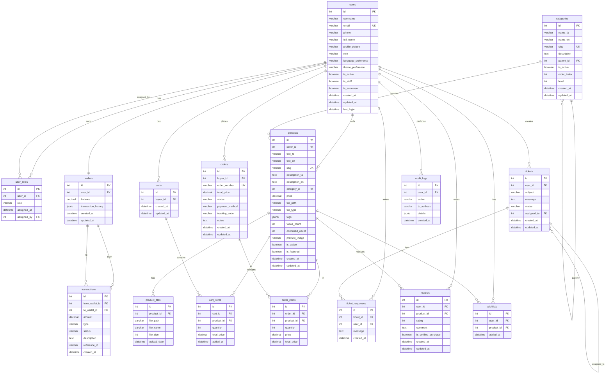

# ERD Diagram - Sci Market System

## Entity Relationship Diagram

## Key Relationships

### 1. User Management
- **users** → **user_roles**: One-to-many (RBAC system)
- **users** → **wallets**: One-to-one (each user has one wallet)

### 2. Financial System
- **wallets** → **transactions**: One-to-many (from/to relationships)
- **transactions** can be between different wallets

### 3. Product Catalog
- **categories** → **categories**: Self-referencing (hierarchical categories)
- **categories** → **products**: One-to-many
- **products** → **product_files**: One-to-many (additional files)

### 4. Shopping System
- **users** → **carts**: One-to-one
- **carts** → **cart_items**: One-to-many
- **cart_items** → **products**: Many-to-one

### 5. Order Management
- **users** → **orders**: One-to-many
- **orders** → **order_items**: One-to-many
- **order_items** → **products**: Many-to-one

### 6. Support System
- **users** → **tickets**: One-to-many
- **tickets** → **ticket_responses**: One-to-many
- **tickets** → **users**: Many-to-one (assigned_to)

### 7. Review System
- **users** → **reviews**: One-to-many
- **products** → **reviews**: One-to-many
- **reviews** have unique constraint on (user_id, product_id)

### 8. Wishlist System
- **users** → **wishlists**: One-to-many
- **products** → **wishlists**: One-to-many
- **wishlists** have unique constraint on (user_id, product_id)

### 9. Audit System
- **users** → **audit_logs**: One-to-many
- **audit_logs** track all user actions

## Database Constraints

### Primary Keys
- All tables have `id` as primary key
- Auto-incrementing integers

### Foreign Keys
- All foreign keys have proper referential integrity
- `ON DELETE CASCADE` for dependent records
- `ON DELETE SET NULL` for optional references

### Unique Constraints
- `users.email` - unique email addresses
- `categories.slug` - unique category slugs
- `products.slug` - unique product slugs
- `orders.order_number` - unique order numbers
- `wishlists(user_id, product_id)` - unique wishlist entries
- `reviews(user_id, product_id)` - unique review per user per product

### Check Constraints
- `price >= 0` for products and order items
- `quantity > 0` for cart items and order items
- `file_size > 0` for product files
- `balance >= 0` for wallets
- `amount > 0` for transactions
- `rating BETWEEN 1 AND 5` for reviews

## Indexes

### Performance Indexes
- Foreign key indexes on all FK columns
- Unique indexes on slug fields
- Composite indexes on frequently queried combinations
- GIN indexes on JSONB fields (tags, transaction_history)
- Full-text search indexes on product titles and descriptions

### Audit Indexes
- Time-based indexes on created_at fields
- Action-based indexes on audit_logs.action
- User-based indexes on user_id fields

## MongoDB Collections (NoSQL)

### Event Logs
- High-volume application events
- TTL: 90 days
- Indexes: action, userId, createdAt

### Search Analytics
- User search queries and results
- Indexes: query, userId, timestamp

### Download Audit
- Product download tracking
- Indexes: productId, userId, timestamp

### Ticket Messages (Optional)
- Large ticket conversations
- Indexes: ticketId, userId, timestamp

## Summary

This ERD represents a complete e-commerce marketplace system with:
- **16 PostgreSQL tables** with proper relationships
- **RBAC system** for user management
- **Financial system** with wallets and transactions
- **Product catalog** with hierarchical categories
- **Shopping cart** and order management
- **Support system** with tickets and responses
- **Review system** with ratings and comments
- **Wishlist system** for user favorites
- **Audit logging** for all actions
- **MongoDB collections** for analytics and logs

The system is designed for scalability, performance, and data integrity with proper constraints, indexes, and relationships.
