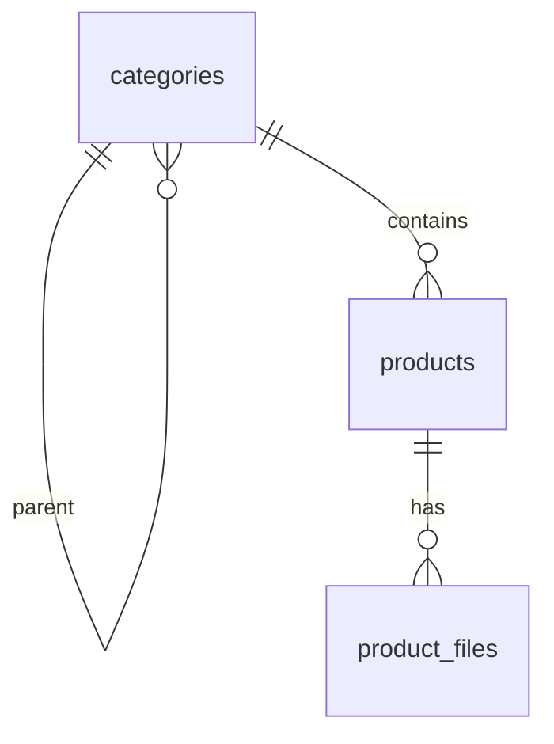
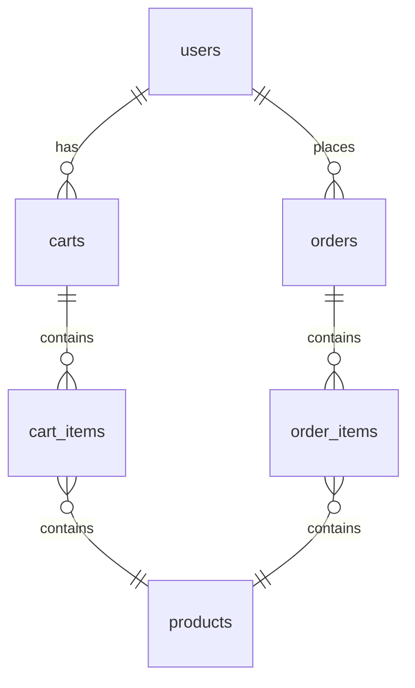
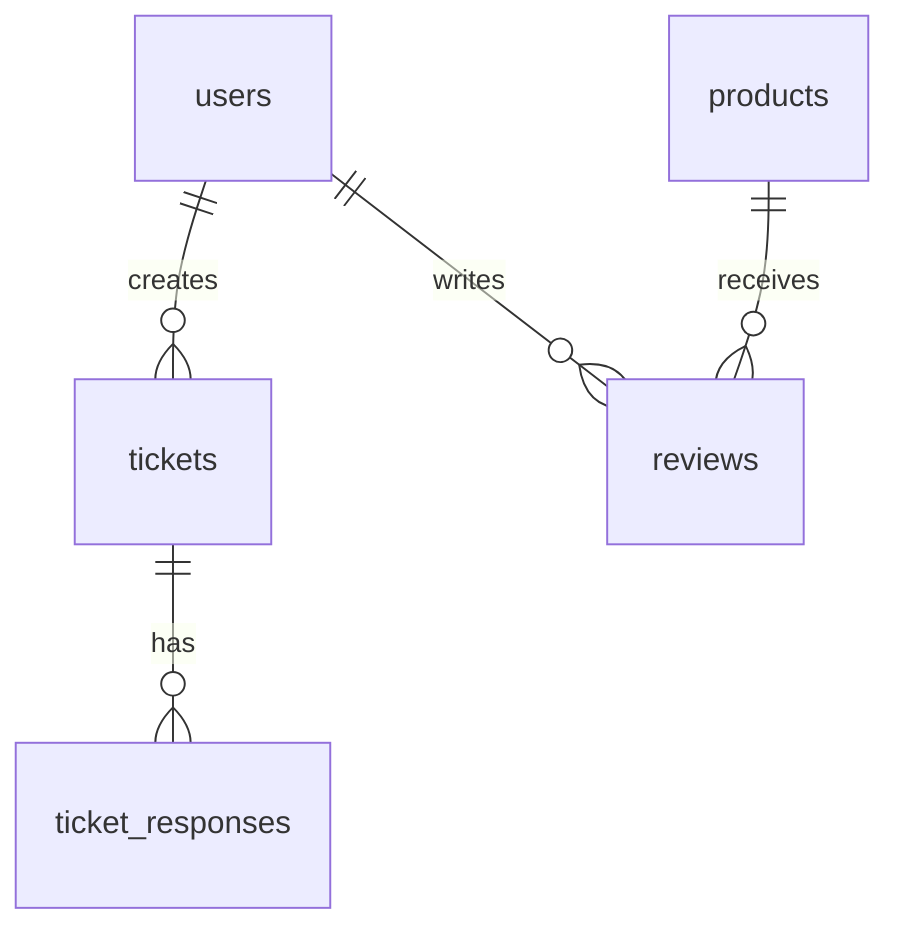
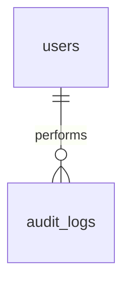

# ER Slices - Focused Views

This file contains smaller ER diagrams for focused areas to ease onboarding.

## Catalog and Content


## Commerce Flow


## Finance
```mermaid
erDiagram
    users ||--|| wallets : owns
    wallets ||--o{ transactions : from
    wallets ||--o{ transactions : to
```

## Support and Feedback


## Compliance / Audit



